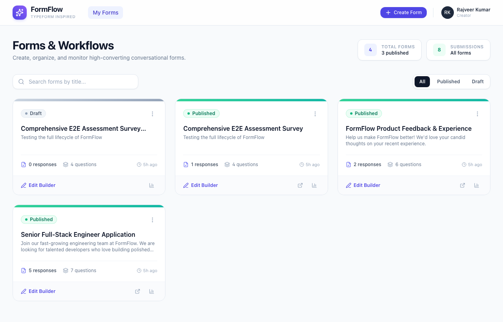
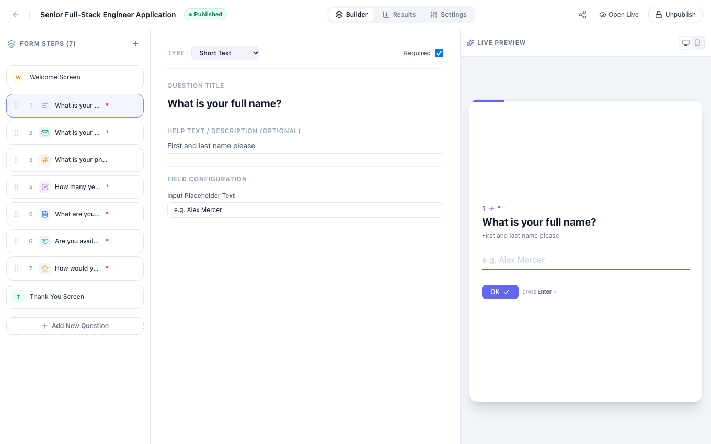
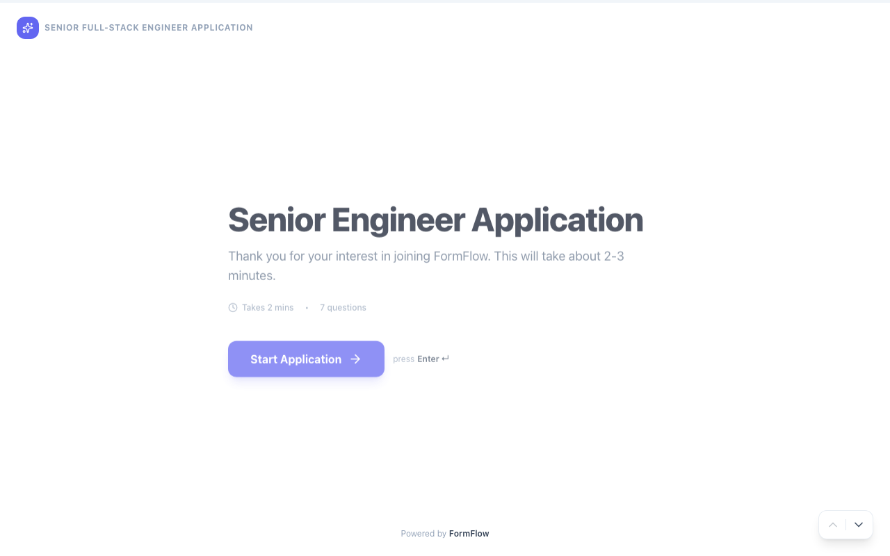
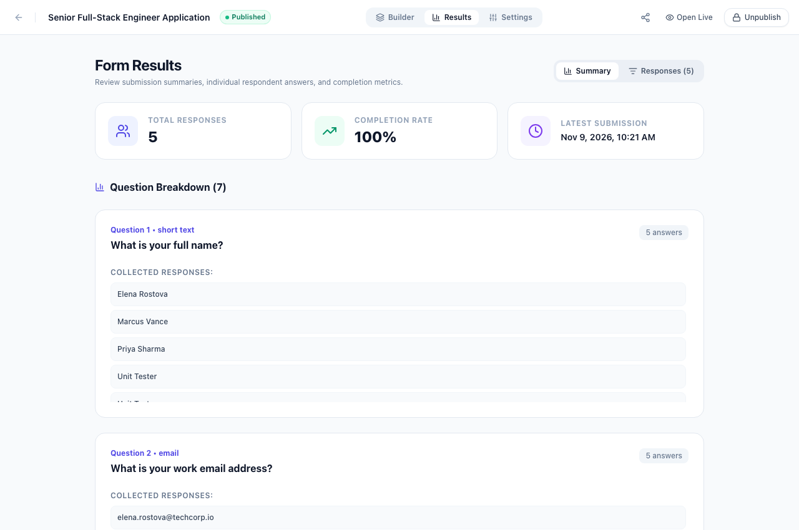

# FormFlow (Form-Filler) ⚡

> A production-quality, Typeform-inspired conversational form-building platform built with Next.js 14, TypeScript, Tailwind CSS, FastAPI, and SQLAlchemy.

[](https://github.com/rajveer-kumar-ravi/Form-Filler/actions)


---

## 📸 Screenshots Showcase

| **Form Dashboard** | **3-Panel Form Builder** |
|:---:|:---:|
|  |  |

| **Conversational Respondent Experience** | **Live Results & Analytics** |
|:---:|:---:|
|  |  |

---

## ✨ Features

### 🛠️ 1. Professional 3-Panel Form Builder
* **Left Panel:** Drag-and-drop question reordering (`@dnd-kit`), Welcome Screen, Question Steps, and Thank-You Screen.
* **Center Panel:** In-depth question configuration:
  * Title & Subtitle / Help text
  * Required / Optional toggle
  * Type-specific settings (choices, min/max numbers, rating scale, accepted file formats)
  * Duplicate, delete, and navigation
* **Right Panel:** Interactive real-time live preview matching the exact respondent interface.

### 📋 2. Nine Supported Question Types
1. **Short Text:** Single-line inputs (Names, Titles, handles).
2. **Long Text:** Multi-line textarea (Feedback, details, essays).
3. **Multiple Choice:** Customizable options with single-select and hotkey navigation (A, B, C, D).
4. **Dropdown:** Compact selection menu for large option lists.
5. **Email Address:** Automatic format validation with error alerts.
6. **Number:** Numeric-only inputs with optional Min/Max range constraints.
7. **Yes / No:** Binary selection with keyboard shortcuts (`Y` / `N`).
8. **Rating Scale:** Configurable rating scales (1–5, 1–7, 1–10) with custom Min/Max labels.
9. **File / PDF Resume:** Drag-and-drop or browse PDF/document file upload (up to 15MB) with real-time upload progress, preview badge, and download links.

### 🎯 3. Conversational Respondent Experience (`/form/[shareId]`)
* One-question-at-a-time focus to maximize completion rates.
* Smooth Framer Motion transitions between questions.
* Full keyboard navigation (Enter to proceed, Up/Down arrows, letter hotkeys).
* Real-time progress bar.
* Responsive on desktop, tablet, and mobile screens.
* Celebratory confetti animation upon submission.

### 📊 4. Results & Analytics Dashboard (`/forms/[id]/results`)
* Key metrics: Total responses, Completion Rate, Average Completion Time.
* Interactive question-by-question breakdown charts.
* Submissions data table with quick preview drawer.
* Dedicated single-response view (`/forms/[id]/responses/[responseId]`).
* Direct download/view links for uploaded PDF resumes.
* 1-Click CSV data export.

### 🧭 5. Interactive Visual User Guide & Guided Tour (`/guide`)
* 10 complete chapters teaching the platform end-to-end.
* Real UI screenshots captured directly from the running application.
* Interactive guided tour with Driver.js that highlights working elements.
* Beginner-friendly explanations.

### 🎁 6. Built-in Bonus Features
* **Interactive Share & Embed Modal:** Direct links, printable QR code generator (scan to fill on phone), HTML `<iframe>` embed snippet, popup button snippet, and 1-click social sharing (WhatsApp, X, LinkedIn, Email).
* **6 SaaS Design Presets:** 1-Click theme styling (Typeform Violet, Midnight Dark, Sunset Rose, Nordic Forest, Electric Amber, Minimal Mono) with custom brand color pickers, typography fonts, and card border radiuses.
* **JSON Submissions Export & Filtering:** Export data in both CSV and structured JSON format, plus live search and completion status filters (`all`, `completed`, `partial`).
* **Web Audio Sound Effects:** Subtle browser-native audio pops, clicks, and celebratory chimes on answering, with an interactive audio toggle switch.
* **Keyboard Cheatsheet Modal:** Typeform-style quick shortcuts reference (Press `?` anywhere to trigger).
* **Form Templates Gallery:** Pre-configured flows for Job Applications (with Resume upload), Customer Satisfaction Surveys, Event RSVP, and Product Feedback.

---

## 🏗️ Architecture & Tech Stack

```
Form-Filler/
├── backend/                  # FastAPI Python backend
│   ├── app/
│   │   ├── routers/          # API endpoints (forms, questions, responses, analytics, upload, public)
│   │   ├── crud.py           # Database operations
│   │   ├── database.py       # SQLAlchemy engine & session
│   │   ├── main.py           # FastAPI application entrypoint & static mount
│   │   ├── models.py         # SQLAlchemy relational database models
│   │   ├── schemas.py        # Pydantic v2 validation schemas
│   │   └── seed.py           # Initial sample data seed
│   ├── scripts/              # Helper utilities
│   ├── tests/                # Automated API & E2E pytest suite
│   ├── uploads/              # Static file storage for uploaded resumes
│   └── requirements.txt      # Python dependencies
├── frontend/                 # Next.js 14 App Router frontend
│   ├── src/
│   │   ├── app/              # Routes (/dashboard, /forms/new, /forms/[id]/builder, /form/[shareId], /guide, etc.)
│   │   ├── components/       # Builder, Respondent, Dashboard, Results, Common UI components
│   │   ├── lib/              # API client and helper utilities
│   │   └── types/            # TypeScript data models and interfaces
│   ├── public/               # Static assets & guide screenshots
│   ├── package.json          # Dependencies & npm scripts
│   └── tailwind.config.ts    # Styling configuration
└── README.md
```

### Stack Details
* **Frontend:** Next.js 14, React 18, TypeScript, Tailwind CSS, Framer Motion, @dnd-kit, Lucide React, Axios, Canvas Confetti.
* **Backend:** FastAPI, Python 3.10+, SQLAlchemy 2.0, Pydantic v2, SQLite (relational schema with foreign keys and cascading deletes), Uvicorn.

---

## 🚀 Quick Start Guide

### Prerequisites
* Python 3.10 or higher
* Node.js 18.x or higher
* npm or yarn

---

### 1. Backend Setup

```bash
# Navigate to backend directory
cd backend

# Create a virtual environment
python3 -m venv .venv

# Activate the virtual environment
# On macOS/Linux:
source .venv/bin/activate
# On Windows:
# .venv\Scripts\activate

# Install dependencies
pip install -r requirements.txt

# Run the FastAPI server
uvicorn app.main:app --host 127.0.0.1 --port 8000 --reload
```

* Backend API runs at: `http://127.0.0.1:8000`
* Interactive API Documentation (Swagger UI): `http://127.0.0.1:8000/docs`

---

### 2. Frontend Setup

```bash
# Open a new terminal and navigate to frontend directory
cd frontend

# Install npm dependencies
npm install

# Start the development server
npm run dev
```

* Frontend Application runs at: `http://localhost:3000`

---

## 🌐 Cloud Deployment Guide (100% Free & Easy)

You can easily deploy FormFlow for free in under 5 minutes using **Vercel** for the Frontend and **Render** (or **Railway**) for the Backend.

### Step 1: Deploy Backend on Render (Free Python Web Service)
1. Sign up / log in to [Render.com](https://render.com) using your GitHub account.
2. Click **New +** > **Web Service**.
3. Connect your GitHub repository: `rajveer-kumar-ravi/Form-Filler`.
4. Configure the settings:
   * **Name:** `formflow-backend`
   * **Root Directory:** Leave empty (repo root) or set to `backend`
   * **Environment:** `Python 3`
   * **Build Command:** `pip install -r backend/requirements.txt`
   * **Start Command:** `uvicorn backend.app.main:app --host 0.0.0.0 --port $PORT`
   * **Plan:** Free
5. Click **Deploy Web Service**.
6. Once deployed, copy your backend URL (e.g. `https://formflow-backend.onrender.com`).

---

### Step 2: Deploy Frontend on Vercel (Official Next.js Platform)
1. Sign up / log in to [Vercel.com](https://vercel.com) using your GitHub account.
2. Click **Add New...** > **Project**.
3. Import your GitHub repository: `rajveer-kumar-ravi/Form-Filler`.
4. In the configuration screen:
   * **Root Directory:** Click **Edit** and select `frontend`.
   * **Framework Preset:** `Next.js` (auto-detected).
   * **Environment Variables:**
     * Name: `NEXT_PUBLIC_API_URL`
     * Value: `https://formflow-backend.onrender.com` *(paste your backend URL from Step 1)*
5. Click **Deploy**.
6. In about 60 seconds, your site is live with a custom URL (e.g., `https://form-filler-xxx.vercel.app`) and free automatic SSL/HTTPS!

---

## 🧪 Running Automated Tests

The backend includes a comprehensive test suite covering form CRUD, question reordering, submissions, analytics, CSV export, and file uploads:

```bash
cd backend
source .venv/bin/activate
pytest tests/ -v
```

---

## 📄 API Endpoints Overview

| Method | Endpoint | Description |
|---|---|---|
| `GET` | `/api/forms` | List all created forms with response counts |
| `POST` | `/api/forms` | Create a new form |
| `GET` | `/api/forms/{id}` | Get form details including questions |
| `PUT` | `/api/forms/{id}` | Update form settings and title |
| `POST` | `/api/forms/{id}/publish` | Publish form and generate shareable link |
| `POST` | `/api/forms/{id}/unpublish` | Unpublish form |
| `POST` | `/api/forms/{id}/duplicate` | Duplicate an existing form |
| `DELETE` | `/api/forms/{id}` | Delete form and all associated questions/responses |
| `POST` | `/api/forms/{id}/questions` | Add a new question to a form |
| `PUT` | `/api/forms/{id}/questions/reorder` | Update question order |
| `POST` | `/api/upload` | Upload resume / PDF file (up to 15MB) |
| `GET` | `/api/public/form/{share_id}` | Public form fetch for respondents |
| `POST` | `/api/public/form/{share_id}/submit` | Public form response submission |
| `GET` | `/api/forms/{id}/analytics` | Overall form performance metrics & question breakdown |
| `GET` | `/api/forms/{id}/responses/export` | Download submissions as CSV file |

---

## 📝 License

This project is licensed under the MIT License.
